<div align="center">

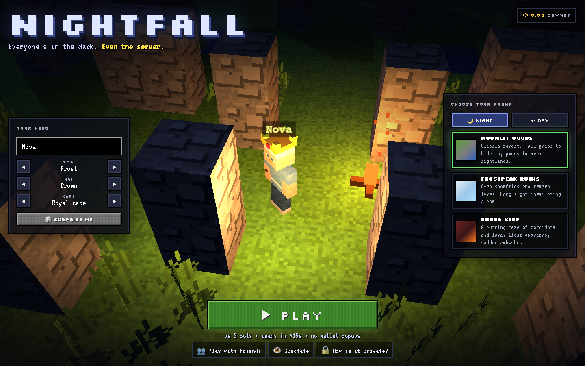

# 🌙 Nightfall

### A real-time battle royale with true fog of war, where even the server can't see you.

Every player's position is sealed inside **MagicBlock's Private Ephemeral Rollup** (an Intel TDX enclave).
Your wallet can read your own line of sight and nothing else.

[](https://nightfall-blitz.vercel.app)
[](https://explorer.solana.com/address/Ccu5SMkkNDj2sBE3mpFhWeUGujQg29aQZ2BKS7CRXbDB?cluster=devnet)


**[Play](https://nightfall-blitz.vercel.app)** · **[Watch it](#-see-it-in-action)** · **[How it works](#-how-it-works)** · **[Run locally](#-run-it-yourself)**

</div>

---

## 📖 Table of contents

- [The idea](#-the-idea)
- [See it in action](#-see-it-in-action)
- [Features](#-features)
- [How to play](#-how-to-play)
- [How it works](#-how-it-works)
  - [Architecture](#architecture)
  - [Life of a match](#life-of-a-match)
  - [Why it can't be cheated](#why-it-cant-be-cheated)
  - [MagicBlock primitives used](#magicblock-primitives-used)
- [Tech stack](#-tech-stack)
- [Run it yourself](#-run-it-yourself)
- [Tests & verification](#-tests--verification)
- [Project structure](#-project-structure)
- [Roadmap](#-roadmap)
- [Credits & license](#-credits--license)

---

## 💡 The idea

Onchain games have always been played **with the cards face up**. Every account is public, so any "hidden"
information (where your opponent is, what's in their hand) can be read straight from the RPC. That's why fog of war,
the backbone of strategy games and battle royales, has been nearly impossible onchain. Dark Forest needed ZK circuits
and ran at a crawl.

**Nightfall fixes it with MagicBlock's Private Ephemeral Rollups.** All positions live in a `World` account sealed inside
a TEE with **zero readers**. Every move, the program recomputes what each player is allowed to see and writes it to a
per-player `Vision` account that **only that player's wallet** can read. The result is a real-time, blocky battle
royale where you see only what your torch lights, and nobody can cheat their way past that, the host included.

> **Try to cheat:** press <kbd>X</kbd> in a match. The X-ray panel queries the TEE with *your own* token:
> `World → null`, `Opponent's Vision → null`, `Your Vision → 155 bytes`.

---

## 🎬 See it in action

<div align="center">
  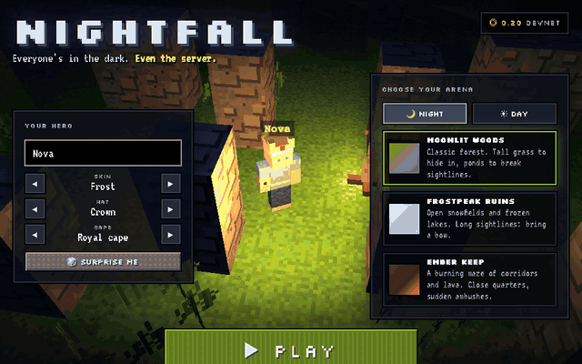
  <br/><sub>A real devnet match recorded headlessly against MagicBlock's TEE. Every step and swing is a transaction.</sub>
</div>

<br/>

<table>
  <tr>
    <td width="50%">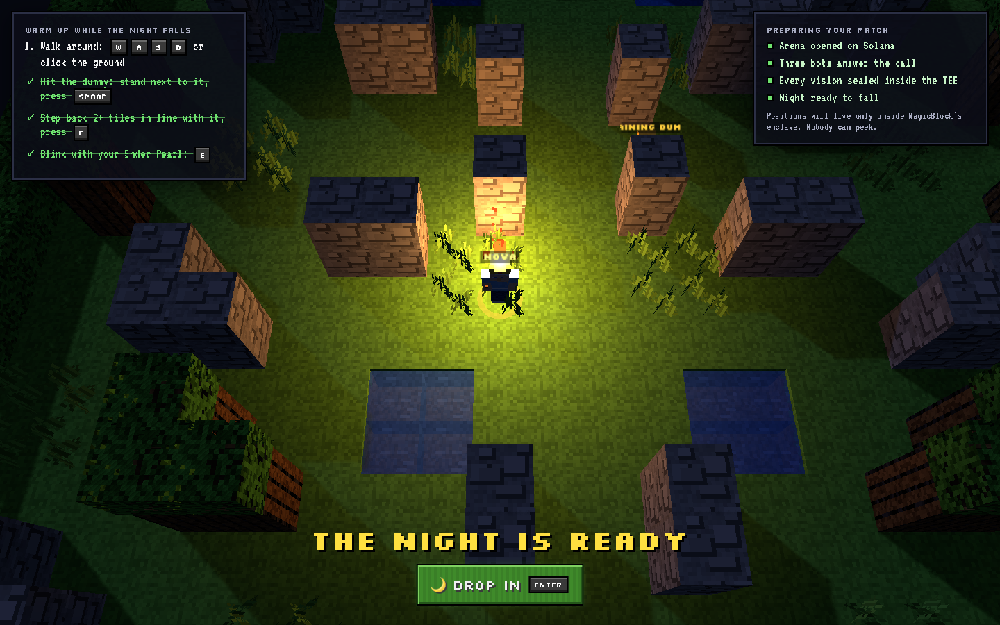<br/><b>Warm-up yard.</b> Learn every control on a training dummy while the arena is set up onchain.</td>
    <td width="50%">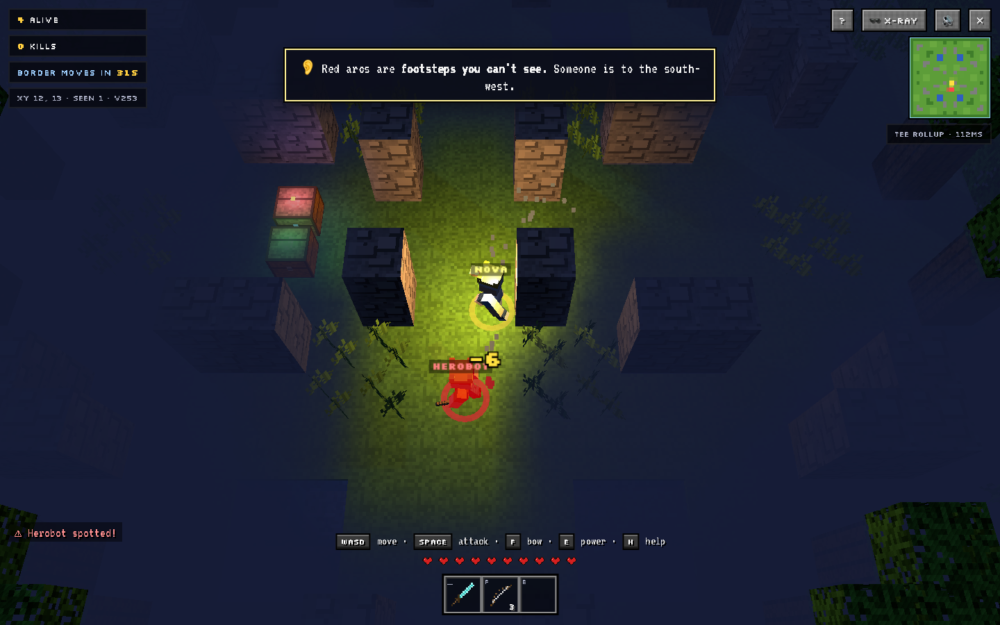<br/><b>Fog of war.</b> Only what your torch reaches. Red arcs = footsteps you hear but can't see.</td>
  </tr>
  <tr>
    <td>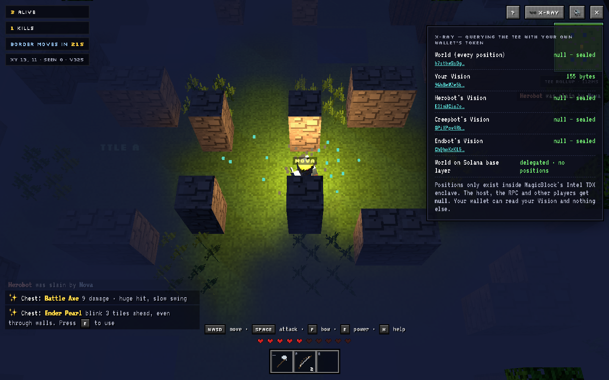<br/><b>Try to cheat.</b> The X-ray asks the TEE for the World and other players' Visions: <code>null</code>.</td>
    <td>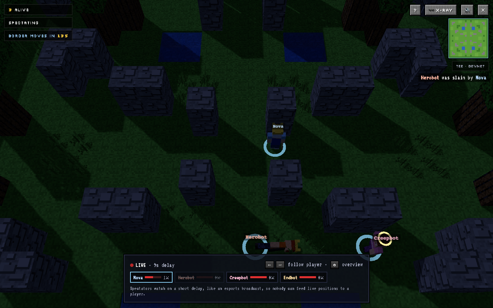<br/><b>Spectate.</b> Every player, on a short broadcast delay so nobody can feed positions to a player.</td>
  </tr>
  <tr>
    <td>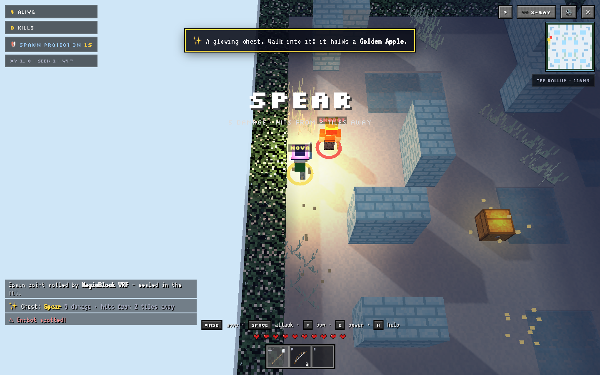<br/><b>Night or day.</b> Daylight arenas see further, but walls and tall grass still hide you.</td>
    <td>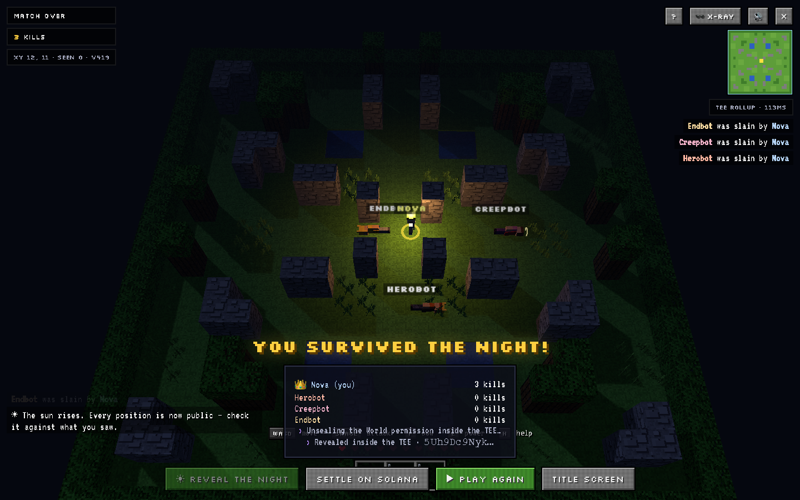<br/><b>Reveal the night.</b> When it ends, the World unseals and anyone can verify what really happened.</td>
  </tr>
  <tr>
    <td>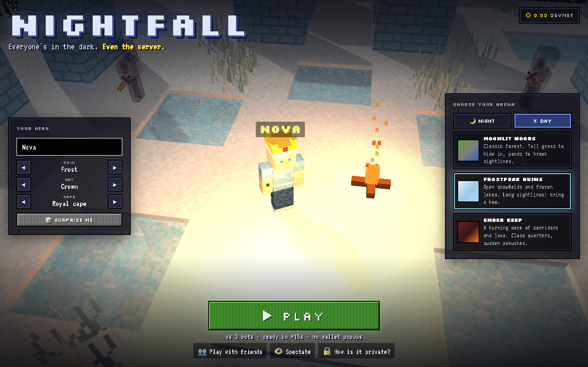<br/><b>Three arenas.</b> Moonlit Woods, Frostpeak Ruins and Ember Keep, each with its own blocks, light and layout.</td>
    <td>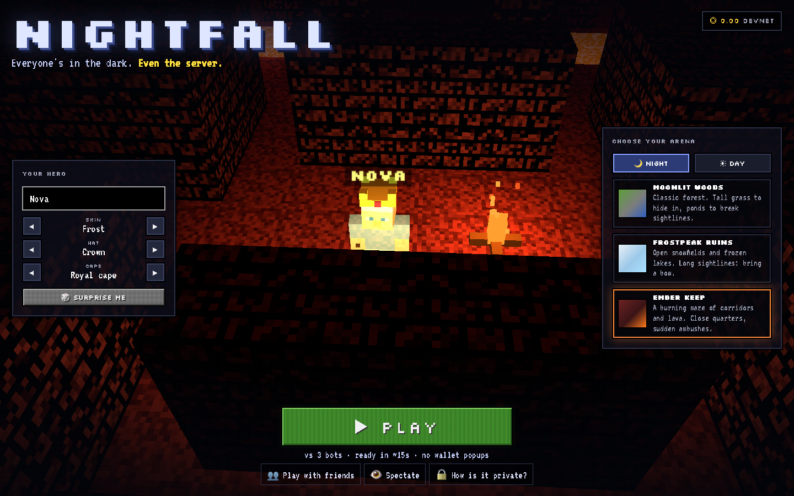<br/><b>Your hero.</b> Six original skins, hats and capes, stored onchain in one byte.</td>
  </tr>
</table>

<div align="center">
  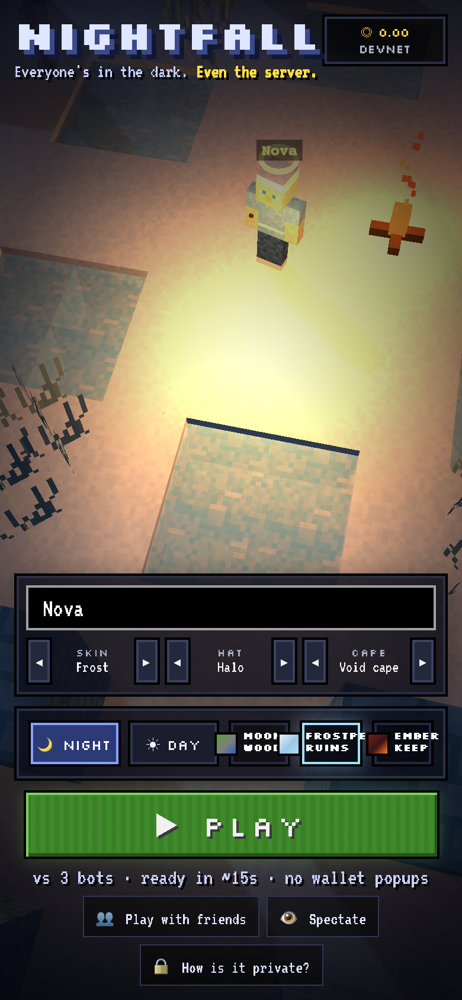
  <br/><sub>Plays on phones too: tap to walk, on-screen attack, bow and power buttons.</sub>
</div>

---

## ✨ Features

**Gameplay**
- ⚔️ **Up to 6 players** (humans or bots) in a shrinking-border battle royale. Last one standing takes the onchain pot.
- 🔦 **Three-layer fog of war:** what you **see** (torch radius + line of sight), what you **remember** (dimmed terrain),
  and what you **hear** (the TEE tells you the *direction* of unseen enemies within 8 tiles, never their position).
- 🌾 **Tall grass** hides you unless someone is right next to you; stone and trees block sight; arrows fly over water.
- 🧰 **10 loot chests:** Diamond Sword, **Battle Axe** (9 dmg, slow), **War Hammer** (knockback), **Spear** (reach 2),
  Golden Apples, arrows, and powers: **Ender Pearl** (blink over walls), **Cloak** (invisible + silent), **Flare** (far sight).
- 🗺️ **Three arenas** × **night or day**. Spawns fill the corners first, plus 10 s of spawn protection.
- 🤖 **Bots with personalities** (archer / brawler / mixed) that play from *their own* sealed Vision, so they can't cheat either.

**Feel & onboarding**
- ▶️ **One button to play.** No wallet popups: a devnet burner lives in the browser.
- 🏕️ **Warm-up yard** while the chain sets up: four quick quests teach every control by doing them, and *you* choose when to drop in.
- 💬 **Just-in-time coaching:** a single tip the first time you see a chest, an enemy, footsteps, or the border.
- 🎮 **Game feel:** hit-stop, damage numbers, screen shake, kill streaks, heartbeat at low health, countdown beeps,
  synthesized night ambience and stereo footsteps. **Zero asset files**: every block, skin, icon and sound is generated in code.
- 👁️ **Spectate without a code:** an onchain registry lists recent arenas, live first; follow any player with ←/→.

---

## 🎮 How to play

| Key | Action |
| --- | --- |
| <kbd>W</kbd><kbd>A</kbd><kbd>S</kbd><kbd>D</kbd> / arrows, or **click the ground** | Move (click-to-walk pathfinds for you) |
| <kbd>Space</kbd> | **Attack**: auto-aims. Melee if someone's in reach, bow if they're lined up |
| <kbd>F</kbd> | Shoot the bow straight ahead |
| <kbd>E</kbd> | Use your power (Pearl / Cloak / Flare) |
| <kbd>H</kbd> · <kbd>X</kbd> · <kbd>M</kbd> | Help · X-ray (try to cheat) · Mute |

**Rules:** you only see what your torch lights → loot chests → the border waits 60 s then closes a tile every 14 s →
outside it you burn → last one standing wins.

---

## 🧠 How it works

### Architecture

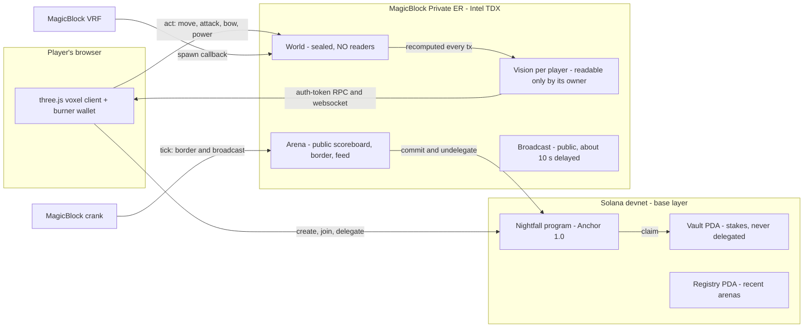

### Life of a match

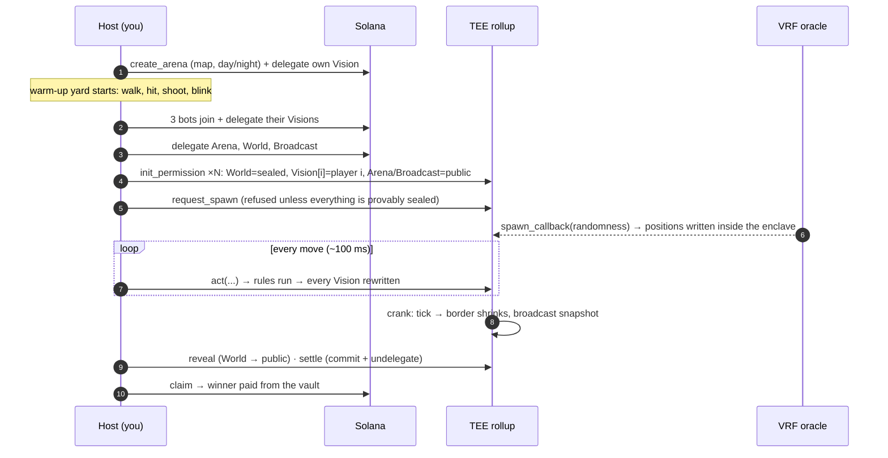

### Why it can't be cheated

| Threat | Defence |
| --- | --- |
| Read positions from the RPC | `World` has an `EphemeralPermission` with **no members**; the TEE returns `null` to everyone, host included |
| Grant yourself access to someone's Vision | `init_permission` **ignores caller input**: the program decides members (Vision → its owner only) |
| Spawn on the public base layer to learn positions | `request_spawn` / `spawn_fallback` parse every permission account and **refuse unless World and all Visions are sealed** |
| Blind an opponent by omitting their Vision | every `act`/`tick` must pass **all** Visions in slot order |
| Leak through logs | no instruction ever logs a position |
| Spectate your own match to see everyone | spectators get a **public broadcast written from snapshots ~10 s old**, like an esports delay |
| Rig the spawn | spawns come from **MagicBlock VRF** inside the rollup (TEE-mixed entropy fallback only if the oracle stalls) |

### MagicBlock primitives used

| Primitive | Where |
| --- | --- |
| **Ephemeral Rollup** | Every step, swing, arrow and power is its own gasless transaction (~100 ms round trip) |
| **Private ER (TEE)** | Sealed `World`, per-player `Vision`, public `Arena`/`Broadcast` via `EphemeralPermission` CPIs |
| **VRF** | `request_spawn` → `spawn_callback` writes spawns and chest loot straight into the sealed World |
| **Crank / scheduler** | `schedule_ticks` puts the border and broadcast on the rollup's scheduler (clients tick as a fallback) |
| **Commit / undelegate** | `settle` brings the result back to Solana; `claim` pays the pot from a never-delegated vault |

---

## 🛠 Tech stack

| Layer | Tech |
| --- | --- |
| Program | Rust 1.89 · Anchor 1.0.2 · `ephemeral-rollups-sdk` 0.17.3 (access-control, VRF, crank) · Agave 3.1.9 |
| Client | TypeScript · three.js · Vite · `@magicblock-labs/ephemeral-rollups-sdk` · `@solana/web3.js` · Anchor TS |
| Art & audio | Procedural pixel textures, voxel characters and items, WebAudio synthesis; no asset files |
| Infra | Solana devnet · MagicBlock devnet TEE (`devnet-tee.magicblock.app`) · Vercel |

---

## 🚀 Run it yourself

**Just play:** <https://nightfall-blitz.vercel.app>. Press **PLAY**; if your burner needs devnet SOL, the game walks you through the faucet.

**Run the client locally**

```bash
git clone https://github.com/codeswithroh/nightfall && cd nightfall/app
npm install
npm run dev            # http://localhost:5173, talks to the deployed devnet program
```

**Fill a lobby from the terminal** (bots funded from `~/.config/solana/id.json`)

```bash
cd app && npm run guest -- <arena code> 3
```

**Build, test and deploy the program**

```bash
# toolchain: Agave 3.1.9, Anchor 1.0.2, Rust 1.89 (rust-toolchain.toml pins it)
anchor build
cargo test --manifest-path programs/nightfall/Cargo.toml    # 12 rule tests
anchor deploy --provider.cluster devnet
cd app && npm run sync-idl
```

---

## ✅ Tests & verification

- **12 rule tests** (`programs/nightfall/src/logic.rs`): line of sight, tall grass, hearing octants, border timing,
  spawn spread and protection, every weapon (axe damage + cooldown, hammer knockback stopped by walls, spear reach),
  chest loot, every power (pearl blinks over walls, cloak hides even adjacent players until you attack, flare range),
  daylight sight, broadcast delay, all three maps.
- **Devnet end-to-end** (`app/tests/e2e.ts`): two players, real TEE, full lifecycle.

```text
match live, vrf = true
guest peeks host vision → null ✅ sealed
guest peeks world → null ✅ sealed
host peeks world → null ✅ sealed (even the host)
spectator reads public arena → ok ✅
player 1 spotted player 0 through the fog at step 18
status 3 winner slot 0 kills [ 1, 0 ]
after reveal, guest reads world → visible ✅
winner received 0.02 SOL
✅ e2e complete
```

- **Played in the browser** end to end: title → warm-up quests → drop in → loot → fight → win → reveal → settle → paid,
  plus a second tab spectating the same match. The previews above were captured from real devnet matches.

---

## 📁 Project structure

```text
nightfall/
├── programs/nightfall/src/
│   ├── lib.rs        # instructions: lobby, delegation, permissions, VRF spawn, act, tick, crank, reveal, settle, claim
│   ├── logic.rs      # pure rules: fog, hearing, weapons, powers, border, broadcast (+ tests)
│   ├── state.rs      # Arena · World · Vision · Broadcast · Registry
│   └── map.rs        # generated by scripts/gen-map.py (3 symmetric, connectivity-checked arenas)
├── app/
│   ├── src/lib/      # NightfallClient: base + TEE connections, auth tokens, reliable send/confirm
│   ├── src/game/     # scene, voxel characters, session (HUD, prediction, spectating), warm-up yard, bots, sfx
│   └── tests/        # e2e.ts (devnet + TEE), guest.ts (terminal bots)
├── scripts/gen-map.py
└── docs/media/       # README previews
```

---

## 🗺 Roadmap

- [ ] Session keys + Phantom/Backpack for real-wallet play (burner stays as the instant option)
- [ ] Server-side bots so matches keep going if the host closes their tab
- [ ] Ranked seasons with an onchain leaderboard (Magic Actions on settle)
- [ ] Squads (2v2v2) with shared team Visions, a natural fit for permission groups
- [ ] Replays from the revealed World + move history

---

## 🙌 Credits & license

Built for the **MagicBlock Solana Blitz** hackathon on MagicBlock's Ephemeral Rollups, Private Ephemeral Rollups,
VRF and crank scheduler.
All art and audio are procedurally generated. The blocky look is a tribute to classic block games; the characters,
items and arenas are original.

Released under the [MIT License](LICENSE).
